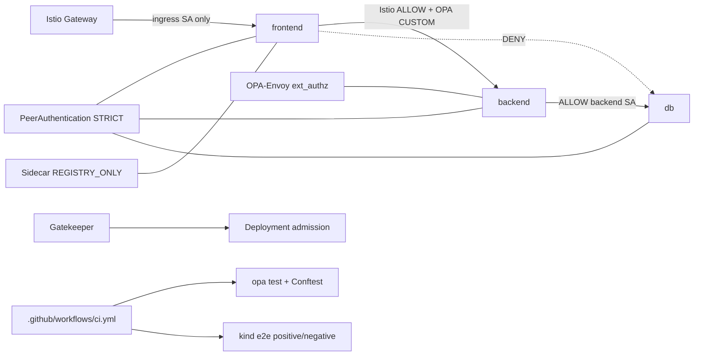

# Zero-Trust with Istio + OPA

Deny-by-default zero-trust service mesh on Kubernetes using Istio STRICT mTLS,
AuthorizationPolicy, OPA as an Istio external authorizer, and Gatekeeper admission.

[](https://github.com/justrunme/zero-trust-istio-opa/actions/workflows/ci.yml)
[](https://github.com/justrunme/zero-trust-istio-opa/releases/latest)
[](LICENSE)
[](https://justrunme.com/cases/zero-trust-service-mesh/)
[](https://securityscorecards.dev/viewer/?uri=github.com/justrunme/zero-trust-istio-opa)

Evidence: [docs/EVIDENCE.md](docs/EVIDENCE.md)

Case study: [Zero Trust Service Mesh](https://justrunme.com/cases/zero-trust-service-mesh/) · [Andrey Lesnikov](https://justrunme.com/)

## What it does

- Enforces STRICT mTLS and explicit deny-by-default `AuthorizationPolicy` in `frontend` / `backend` / `db`
- Wires OPA-Envoy as an Istio `extensionProviders` external authorizer (`action: CUSTOM`) on backend
- Evaluates Rego against the real Envoy `CheckRequest` (SPIFFE `source.principal`, method/path/headers)
- Restricts egress with `Sidecar` `outboundTrafficPolicy: REGISTRY_ONLY` plus a `ServiceEntry` allowlist
- Adds OPA Gatekeeper admission constraints (required `app` label)
- Proves positive and negative paths in kind e2e via `scripts/test_policy.sh` (no failure masking)

## Why

- Mesh mTLS alone is not zero-trust; authorization, external authz, admission, and egress close the gaps
- Policy should fail CI when denied paths start succeeding

## Quickstart

```bash
./scripts/deploy_all.sh
./scripts/test_policy.sh
```

## Architecture



## Key Features

* **Microservices:** `frontend`, `backend`, and `db` with dedicated ServiceAccounts in separate namespaces.
* **Istio:** Sidecar injection, STRICT mTLS, namespace `allow-nothing` policies, principal-based allow-lists
  (ingress→frontend, frontend→backend, backend→db).
* **OPA external authorizer:** `meshConfig.extensionProviders.envoyExtAuthzGrpc` → `opa.istio-system:9191`,
  `AuthorizationPolicy action: CUSTOM` on backend. Policy ConfigMap is generated from `opa/policy.rego`
  at deploy time so Rego cannot drift from the deployed bundle.
* **Egress control:** `Sidecar` `REGISTRY_ONLY` in app namespaces + `ServiceEntry` allowlist (`httpbin.org`).
* **OPA Gatekeeper:** ConstraintTemplate + constraint requiring an `app` label on Deployments.
* **CI:** `opa test --coverage --threshold 90`, Conftest (app + mesh), actionlint, then kind e2e that asserts:
  * authorized path **200**
  * unauthorized principal **403** (OPA / Istio)
  * OPA path deny (`/admin`) **403**
  * plaintext from a non-mesh namespace rejected (STRICT mTLS)
  * Gatekeeper denies unlabeled Deployment
  * egress to a non-allowlisted host blocked

## Pinned versions

See `scripts/versions.env` (kept in sync with `.github/workflows/ci.yml`):

| Component | Version |
|-----------|---------|
| Istio | 1.31.1 |
| OPA / OPA-Envoy | 1.21.1 |
| Gatekeeper (Helm chart) | 3.23.1 |
| kind | v0.33.0 |
| kind node image | kindest/node:v1.35.8 (digest-pinned) |

## Project Structure

```
zero-trust-istio-opa/
├── manifests/
│   ├── istio-operator.yaml           # extensionProviders: opa-ext-authz
│   ├── kind/cluster.yaml
│   ├── namespace.yaml
│   ├── app/                          # workloads + ServiceAccounts
│   ├── istio/                        # PeerAuth, AuthZ, Sidecar, ServiceEntry
│   ├── opa/                          # OPA-Envoy Deployment + CUSTOM AuthZ
│   └── fixtures/                     # intentionally bad manifests for e2e
├── opa/
│   ├── policy.rego                   # Envoy CheckRequest Rego (deny-by-default)
│   └── policy_test.rego
├── policies/                         # Gatekeeper template + constraint
├── policy/
│   ├── conftest/                     # Deployment label checks
│   └── conftest-mesh/                # STRICT + allow-nothing combine checks
└── scripts/
    ├── deploy_all.sh
    ├── test_policy.sh
    └── versions.env
```

## Quick start (local)

Requirements: Docker, kubectl, Helm, curl.

```bash
./scripts/deploy_all.sh
./scripts/test_policy.sh
```

`test_policy.sh` fails unless all of the following hold:

1. Frontend SA → backend `/` returns **HTTP 200**
2. DB SA → backend returns **HTTP 403**
3. Frontend SA → backend `/admin` returns **HTTP 403** (OPA)
4. Backend SA → db returns **HTTP 200**; frontend SA → db returns **HTTP 403**
5. Plaintext client (no sidecar) cannot get **HTTP 200** from backend
6. Gatekeeper rejects a Deployment missing `app`
7. Egress from the mesh to `https://example.com` is blocked

## CI/CD Status

Workflow jobs:

1. **lint-and-unit** — `opa test` (≥90% coverage), Conftest on app + mesh, actionlint
2. **zero-trust-e2e** — kind + Istio (OPA extension provider) + OPA-Envoy + Gatekeeper + `scripts/test_policy.sh`

## Security Summary Snapshot

<!-- SECURITY_SUMMARY_START -->
See the `zero-trust-security-report` artifact from the latest CI run for live
AuthorizationPolicy, Sidecar, OPA, and Gatekeeper status. `sample-summary.md` has a static example.
<!-- SECURITY_SUMMARY_END -->
