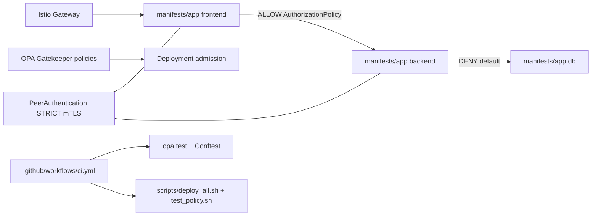

# Zero-Trust with Istio + OPA

Deny-by-default zero-trust service mesh on Kubernetes using Istio and Open Policy Agent.

[](https://github.com/justrunme/zero-trust-istio-opa/actions/workflows/ci.yml)
[](https://github.com/justrunme/zero-trust-istio-opa/releases/latest)
[](LICENSE)
[](https://justrunme.com/cases/zero-trust-service-mesh/)

Case study: [Zero Trust Service Mesh](https://justrunme.com/cases/zero-trust-service-mesh/) · [Andrey Lesnikov](https://justrunme.com/)

## What it does

- Enforces STRICT mTLS and `AuthorizationPolicy` allow-lists across frontend / backend / db namespaces
- Adds OPA Gatekeeper admission constraints (required `app` label) and unit-tested Rego policy
- Proves allow (HTTP 200) and deny (HTTP 403) paths in Kind e2e via `scripts/test_policy.sh`

## Why

- Mesh mTLS alone is not zero-trust; authorization and admission policy close the remaining gaps
- Policy should fail CI when denied paths start succeeding

## Quickstart

```bash
./scripts/deploy_all.sh
./scripts/test_policy.sh
```

## Architecture



## Project Goal

This project demonstrates a deny-by-default zero-trust model on Kubernetes using
Istio for service-mesh mTLS and authorization, Open Policy Agent (OPA) Rego for
external-authz style decisions, and OPA Gatekeeper for admission-time label
constraints.

## Key Features

* **Microservices:** `frontend`, `backend`, and `db` workloads in separate namespaces.
* **Istio:** Sidecar injection, STRICT mTLS (`PeerAuthentication`), and
  `AuthorizationPolicy` allow-lists (ingress→frontend, frontend→backend).
* **OPA Gatekeeper:** ConstraintTemplate + constraint requiring an `app` label on Deployments.
* **OPA Rego / OPA-Envoy:** Unit-tested `opa/policy.rego` (optional Envoy deployment under `manifests/opa/`).
* **CI:** GitHub Actions runs `opa test`, Conftest, actionlint, then a kind-based e2e that asserts **403** (denied) and **200** (allowed).

## Pinned versions

See `scripts/versions.env` (kept in sync with `.github/workflows/ci.yml`):

| Component | Version |
|-----------|---------|
| Istio | 1.31.1 |
| OPA / OPA-Envoy | 1.21.1 |
| Gatekeeper (Helm chart) | 3.23.1 |
| kind | v0.33.0 |
| kind node image | kindest/node:v1.35.8 (digest-pinned) |

## Technologies

* **Kubernetes:** kind for local and CI clusters
* **Istio:** traffic management, mTLS, AuthorizationPolicy
* **OPA Gatekeeper:** admission policy enforcement
* **OPA:** Rego unit tests; optional OPA-Envoy deployment
* **Kiali / Jaeger / Prometheus / Grafana:** available via Istio demo profile addons (optional)
* **GitHub Actions:** policy unit tests + kind e2e

## Project Structure

```
zero-trust-istio-opa/
├── README.md
├── CHANGELOG.md
├── SECURITY-REPORT.md
├── sample-summary.md
├── .github/
│   ├── dependabot.yml
│   └── workflows/
│       └── ci.yml
├── manifests/
│   ├── kind/
│   │   └── cluster.yaml              # kind cluster (K8s 1.35.8 node image)
│   ├── namespace.yaml
│   ├── app/
│   │   ├── frontend.yaml
│   │   ├── backend.yaml
│   │   └── db.yaml
│   ├── istio/
│   │   ├── gateway.yaml
│   │   ├── virtualservice.yaml
│   │   ├── destinationrule.yaml
│   │   ├── istio-injection-label.yaml
│   │   ├── peerauthentication.yaml
│   │   ├── authorizationpolicy-allow-ingress-frontend.yaml
│   │   └── authorizationpolicy-allow-frontend-backend.yaml
│   └── opa/
│       ├── config.yaml               # optional OPA-Envoy ConfigMap
│       └── deployment.yaml           # optional OPA-Envoy Deployment
├── policies/
│   ├── templates/
│   │   └── k8srequiredlabels.yaml    # Gatekeeper ConstraintTemplate
│   └── constraints/
│       └── must-have-app-label.yaml
├── opa/
│   ├── policy.rego
│   └── policy_test.rego
├── policy/
│   └── conftest/
│       └── deployment.rego
├── scripts/
│   ├── versions.env
│   ├── deploy_all.sh                 # kind + Istio + Gatekeeper + app
│   └── test_policy.sh                # asserts 200 allowed / 403 denied
└── dashboards/
    ├── grafana.json
    └── kiali-config.yaml
```

## Quick start (local)

Requirements: Docker, kubectl, Helm, curl.

```bash
./scripts/deploy_all.sh
./scripts/test_policy.sh
```

`test_policy.sh` fails the process unless:

1. A client in `frontend` (default SA) receives **HTTP 200** from `backend`.
2. A client in `db` receives **HTTP 403** from `backend`.

## CI/CD Status

[](https://github.com/justrunme/zero-trust-istio-opa/actions/workflows/ci.yml)

Workflow jobs:

1. **lint-and-unit** — `opa test`, Conftest on `manifests/app`, actionlint
2. **zero-trust-e2e** — kind + Istio + Gatekeeper + `scripts/test_policy.sh`

## Security Summary Snapshot

<!-- SECURITY_SUMMARY_START -->
See the `zero-trust-security-report` artifact from the latest CI run for live
AuthorizationPolicy and Gatekeeper status. `sample-summary.md` has a static example.
<!-- SECURITY_SUMMARY_END -->
